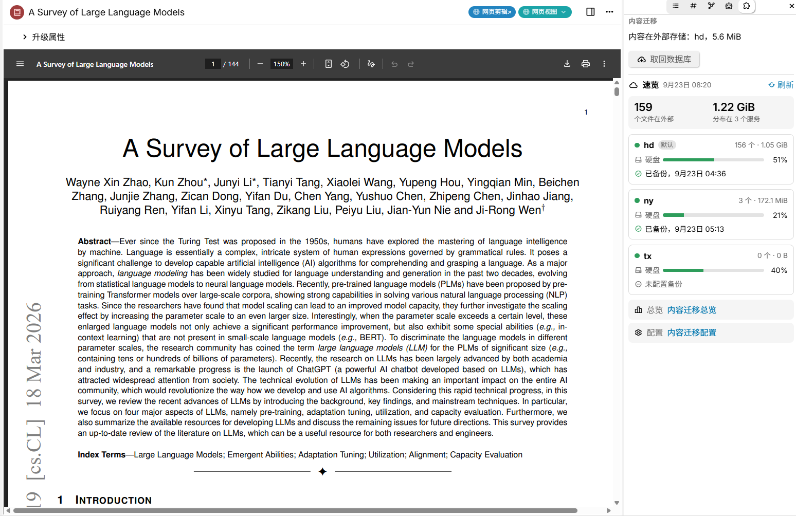
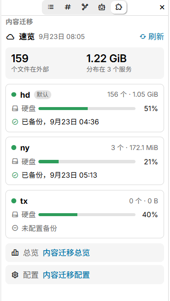

# blobstore

[中文](README.md)

**A Trilium plugin that moves large files out of your notes into external storage, leaving only a placeholder in the database, and brings them back on demand.**
The Trilium database, and every backup of it, no longer has to carry those files around.

Once the plugin is installed, every file note gets a "Content relocation" card in the right-hand panel.
"Move to external storage" uploads the file's bytes to the storage service and turns the note into a `webView` pointing at them; the note still opens in Trilium as before.
"Retrieve to database" brings the bytes back and turns the note into a `file` note again.
A separate "Content relocation overview" note lists every service's state, its backup status, and any records that do not match.



Besides the plugin, the same program provides two companion pieces: the storage service that receives the bytes (installed on a server), and a command-line client for moving notes out and back in bulk (run on a machine that can reach Trilium).
The plugin and the command line keep the same bookkeeping on the notes, so they can be used interchangeably.

| Role | How | Where |
|---|---|---|
| Trilium plugin | `blobstore plugin` writes the import zip; import it into Trilium | inside Trilium |
| Storage service | `blobstore` (no arguments, as systemd runs it); `blobstore install` sets it up as a service | server |
| Command line | `blobstore list/move/back/status/label` | a machine that can reach Trilium |

**The service holds no Trilium credentials.** It only receives bytes, stores them, hands out links, and returns or deletes them on request.
It knows nothing about notes, labels, or databases, never reads an ETAPI token, and never opens the Trilium database.
Notes are changed only by the plugin (inside Trilium) and the command line (on your machine); the tokens live on that side alone.
Even if the service's endpoints were reached by someone else, no note could be altered through them.

## Getting started

1. **Install the service**: cross-compile the Linux build, copy it to the server, and run `blobstore install -public-base <public URL>` as root.
   It prints the address and token to put into the plugin's configuration. Behind a reverse proxy, raise the proxy's body-size limit and timeouts.
   → [Server deployment](https://gitea.chenzhuo.com.cn/zhuo/blobstore/wiki/服务端部署)
2. **Install the plugin**: `blobstore plugin` writes `blobstore-plugin-<version>.zip`. Import it in Trilium (untick "Safe import"),
   enable backend scripts under Settings → Security, and reload the page.
   → [Plugin](https://gitea.chenzhuo.com.cn/zhuo/blobstore/wiki/插件)
3. **Fill in the configuration**: the first time a file note is opened, the plugin creates a "Content relocation configuration" note next to the widget note.
   Put the address and token from step 1 into it. From then on every file note's card can move the file out and bring it back.

The lower half of the card is a summary: the total number and size of files kept externally, then for each service its file count, disk usage, and last backup, followed by links to the overview note and the configuration note.



## Documentation

Usage, protocol, and configuration are documented in the [Wiki](https://gitea.chenzhuo.com.cn/zhuo/blobstore/wiki) (in Chinese):

| Page | Contents |
|---|---|
| [Plugin](https://gitea.chenzhuo.com.cn/zhuo/blobstore/wiki/插件) | installing and updating, the configuration note, the overview page and the card |
| [Records on the note](https://gitea.chenzhuo.com.cn/zhuo/blobstore/wiki/笔记上的记录) | the four labels written on a moved note, the ordering principle behind every operation |
| [Server protocol](https://gitea.chenzhuo.com.cn/zhuo/blobstore/wiki/服务端协议) | HTTP endpoints, authentication, access keys, groups |
| [Server deployment](https://gitea.chenzhuo.com.cn/zhuo/blobstore/wiki/服务端部署) | storage layout, systemd installation, reverse proxy, environment variables |
| [Backup to cloud storage](https://gitea.chenzhuo.com.cn/zhuo/blobstore/wiki/备份到云盘) | the daily encrypted backup and its status file |
| [Command line](https://gitea.chenzhuo.com.cn/zhuo/blobstore/wiki/命令行) | bulk move and retrieve: commands, steps, environment variables |
| [Build](https://gitea.chenzhuo.com.cn/zhuo/blobstore/wiki/构建) | compiling, version number |

## Repository

One Go module, one program, with roles selected by subcommand:

```
main.go              dispatches subcommands; with no arguments it only calls server.Run
plugin/              the Trilium plugin's scripts, embedded in the binary and packed into the import zip by the plugin subcommand
internal/server/     the storage service: protocol, groups, storage
internal/relocate/   the command line: bulk relocation over ETAPI
internal/install/    install / uninstall: set up as a systemd service
deploy/              the systemd unit (embedded), the encrypted-backup script and its units
```

The service's code never imports the command line or the plugin; the service reads only `BLOBSTORE_*` environment variables and the command line only `RELOCATE_*`.

```bash
go build -trimpath -o blobstore.exe .                                          # local machine
GOOS=linux GOARCH=amd64 CGO_ENABLED=0 go build -trimpath -o deploy/blobstore .  # server
./blobstore.exe -version
```

The version number lives only in the `version` variable in `main.go`; the plugin zip's file name is taken from it.
