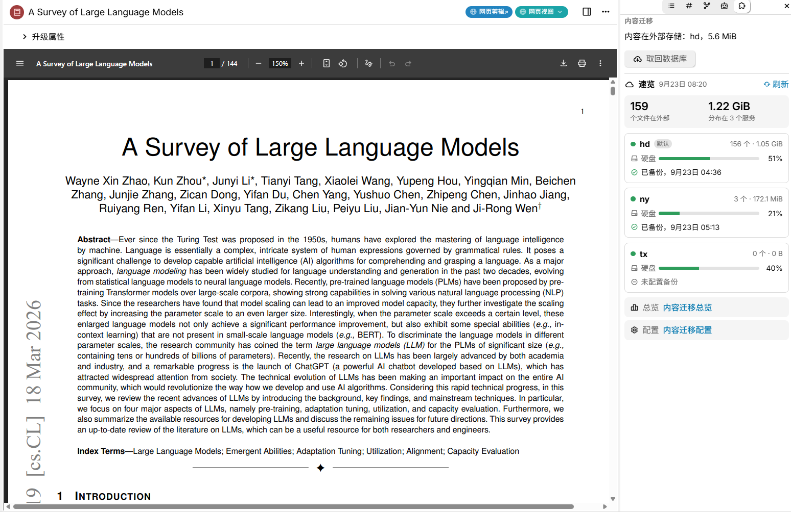
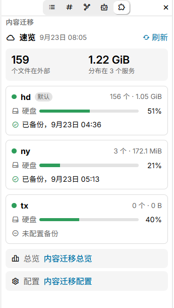

# blobstore

**一个 Trilium 插件,把笔记里的大文件搬到外部存放,库里只留一个占位,需要时再取回。**
Trilium 的数据库和它的每一份备份因此不必反复携带大文件。

插件装进 Trilium 之后,每篇文件笔记的右侧面板多出一张「内容迁移」卡片:点「搬到外部存储」,文件的字节
上传到外部的存放服务,笔记变成指向它的 `webView`,在 Trilium 里照常打开;点「取回数据库」,字节回到库里,
笔记变回 `file` 类型。另有一篇「内容迁移总览」笔记,列出每个服务的状态、备份情况与对不上的记录。



插件之外,同一个程序还提供两样配套的东西:接收字节的存放服务(装在服务器上),以及批量搬出与取回的命令行
(在能连到 Trilium 的本机上跑)。插件与命令行记同一套账,交替使用不冲突。

| 角色 | 怎么用 | 在哪运行 |
|---|---|---|
| Trilium 插件 | `blobstore plugin` 生成导入 zip,导入 Trilium | 装在 Trilium 里 |
| 存放服务 | `blobstore`(不带参数,systemd 这样启动);`blobstore install` 装成服务 | 服务器 |
| 命令行 | `blobstore list/move/back/status/label` | 能连到 Trilium 的本机 |

**服务端不持有任何 Trilium 凭据**:它只收字节、存起来、给链接、按需取回或删除,不认识笔记、标签、库这些概念,
不读 ETAPI 令牌,也不读 Trilium 的数据库。改笔记的是插件(在 Trilium 里)与命令行(在本机),令牌只在它们那一侧。
所以服务端的接口即便被人摸到,也改不了任何一条笔记。

## 从零用起来

1. **装服务端**:交叉编译出 Linux 版本,传到服务器,以 root 执行 `blobstore install -public-base <对外地址>`;
   它会打印要填进插件配置的地址与令牌。挂在反向代理后面时代理要放开请求体大小与超时。
   → [服务端部署](https://gitea.chenzhuo.com.cn/zhuo/blobstore/wiki/服务端部署)
2. **装插件**:`blobstore plugin` 生成 `blobstore-plugin-<版本>.zip`,在 Trilium 里导入(取消勾选「安全导入」),
   在「设置 → 安全」里打开后端脚本,刷新页面。
   → [插件](https://gitea.chenzhuo.com.cn/zhuo/blobstore/wiki/插件)
3. **填配置**:第一次打开文件笔记时,插件在小部件笔记旁边建一篇「内容迁移配置」,把第 1 步打印的地址与令牌填进去。
   之后每篇文件笔记的卡片上就能搬出与取回。

卡片下半部分是速览:外部文件的总数与总大小,每个服务的文件数、硬盘使用率与最近一次备份,再往下是到总览页与配置笔记的链接。



## 文档

用法、协议与配置都在 [Wiki](https://gitea.chenzhuo.com.cn/zhuo/blobstore/wiki) 里:

| 页面 | 内容 |
|---|---|
| [插件](https://gitea.chenzhuo.com.cn/zhuo/blobstore/wiki/插件) | 安装与更新、配置笔记、总览页与卡片 |
| [笔记上的记录](https://gitea.chenzhuo.com.cn/zhuo/blobstore/wiki/笔记上的记录) | 搬出后笔记上的四条标签、操作次序的原则 |
| [服务端协议](https://gitea.chenzhuo.com.cn/zhuo/blobstore/wiki/服务端协议) | HTTP 接口、鉴权、访问串、分组 |
| [服务端部署](https://gitea.chenzhuo.com.cn/zhuo/blobstore/wiki/服务端部署) | 存储布局、装成 systemd 服务、反向代理、环境变量 |
| [备份到云盘](https://gitea.chenzhuo.com.cn/zhuo/blobstore/wiki/备份到云盘) | 每天一次的加密备份与状态文件 |
| [命令行](https://gitea.chenzhuo.com.cn/zhuo/blobstore/wiki/命令行) | 批量搬出与取回的命令、步骤与环境变量 |
| [构建](https://gitea.chenzhuo.com.cn/zhuo/blobstore/wiki/构建) | 编译、版本号 |

## 仓库

一个 Go module、一个程序,按子命令分角色:

```
main.go              分发子命令;不带参数时只调用 server.Run
plugin/              Trilium 插件的脚本,编进程序,由 plugin 子命令打成导入 zip
internal/server/     存放服务:协议、分组、存储
internal/relocate/   命令行:经 ETAPI 批量搬运
internal/install/    install / uninstall:装成 systemd 服务
deploy/              systemd 单元(编进程序)、加密备份脚本与单元
```

服务的代码不引用命令行与插件的代码;服务端的环境变量都是 `BLOBSTORE_*`,命令行的都是 `RELOCATE_*`。

```bash
go build -trimpath -o blobstore.exe .                                          # 本机
GOOS=linux GOARCH=amd64 CGO_ENABLED=0 go build -trimpath -o deploy/blobstore .  # 服务器
./blobstore.exe -version
```

版本号只在 `main.go` 的 `version` 变量里,插件 zip 的文件名取自它。
